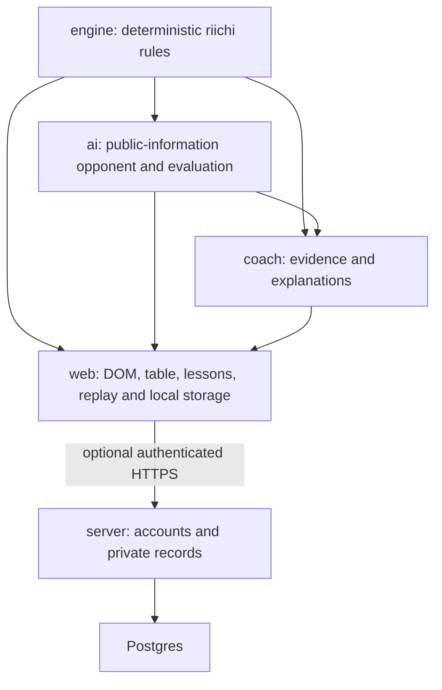

# Architecture overview

Status: implemented baseline, focused foundations and approved starter learning
surfaces, with proposed extensions
explicitly labeled. See [audit](../audit/architecture-audit.md) for defects found
at `989927b` and [roadmap](../product/roadmap.md) for remaining work.

## Runtime and dependency flow

OpenMahjong is an npm-workspaces TypeScript monorepo. The browser can play and
learn as a guest without contacting the account server. The account API adds
persistence; it does not run official online matches.

Arrows mean “provides to,” except the labeled request/storage arrows. No hidden
wall/other-hand state belongs in a coach or analysis input. A full internal event
log can contain hidden information and must not be treated as an online client
message format.

## Package ownership

| Package | Public responsibilities | Excluded responsibility |
|---|---|---|
| engine | Tiles/RNG/wall, shanten, score calculation, legal contexts, deterministic hand/match flow | DOM, accounts, network access, strategic preferences |
| ai | Fast hand analysis, discard/call/riichi policy, documented defensive heuristics | Secret wall/other hands, claims of proven optimal strategy |
| coach | Structured explanations built from evaluated facts; analysis contracts | Inventing legal actions or numerical facts in prose |
| web | Interaction, view-model folding, animation, lessons, progress/storage, optional account API | Independent scoring/rules authority |
| server | OAuth/session/CSRF, validated user-scoped persistence, settings and private statistics | Trusting browser records for official results or ratings |

Keep pure education/review models in focused modules before creating another
package. Split packages when they establish an actual reuse/build boundary,
not to relocate a large file under a new name.

## Game and presentation state

`Game.run()` executes synchronously through four `Policy` objects. A policy
receives its own `PlayerView` and a legal-action context. The client runner
records all decisions, reconstructs a seeded game, and suspends at the human's
next decision. `TableModel` folds event prefixes into the presented board;
`App` animates events and displays controls.

This design supplies deterministic saves without serializing a live JavaScript
stack. Its cost grows as prefixes get longer. It remains until benchmarks justify
an explicit step/snapshot interface; see ARCH-002. Do not add a second partially
implemented game-state machine in the renderer to improve perceived speed.

Replay compatibility includes executable engine behavior, not only a JSON schema.
See [replay contract](replay.md). Frozen legacy implementations are compatibility
adapters for old saves, not code to improve or use for new games.

The headless `review.ts` adapter consumes recorded actions in one reconstruction,
captures detached/frozen human decision views and indexes hand/decision boundaries.
It stops at a partial prefix without inventing additional AI moves. Analysis is
lazy and limited to current-version discard decisions; historical v1 decisions
are display-only. This provides review data/navigation without changing the
ordinary runner's per-action reconstruction. `review-ui.ts` presents this data
with hand/decision navigation, original public table details, physical-discard
comparisons and a related-practice bridge. Legacy v1 remains display-only.
See [decision review](review.md).

## Information boundaries

- The engine owns full game state. Public seat views expose only the seat's own
  hand plus legitimate public information.
- AI and coaching operate on that public view. A visibility count must count a
  physical tile once even if it appears in both discard history and a called meld.
- Retrospective player-perspective evaluation is reconstructed at the decision
  boundary; later events and opponent hands are excluded.
- Full-information replay, when implemented, must be separately labeled and
  cannot feed the default decision-quality evaluation.
- Client-submitted history is private, unrated, untrusted data. Session ownership
  limits access; shape validation does not turn it into an official result.

See [analysis architecture](analysis.md) and [methodology](../analysis/methodology.md).

## Educational state

The existing Learn surface uses `LessonController` and real seeded scenes.
Wrong actions remain at the same step with corrective feedback. The focused
`education/` modules separate versioned curriculum/skills, bounded scene progress,
engine-validated exercises and practice evidence from the renderer. Version
mismatches migrate explicitly or reset the incompatible active scene while
preserving valid completions.

`practice-ui.ts` presents thirteen curated, engine-validated exercises across
eight starter categories. Wrong answers remain retryable, selections and
assistance survive reload, and optional recommendations prioritize due/unseen
content without locking categories. It retains content/ruleset versions and
assisted/unassisted evidence. Tutorial completion remains evidence of exposure,
not proof of mastery. A starter Practice screen does not establish a complete
advanced curriculum, adaptive difficulty system or measured learning benefit.

Practice and Review use the owner-approved v7 native-width learning shell, with a
430px maximum, scrollable content and persistent navigation. It avoids scaling
44px controls below their physical minimum on 360px phones. Existing table
geometry is unchanged.

See [curriculum](../education/curriculum.md), [lesson framework](../education/lesson-framework.md),
[practice](../education/practice-system.md), and [progress](../education/progress-model.md).

## Persistence and account sync

Guest settings, resumable game, history, lesson/practice evidence and saved
review references use localStorage;
blocked/full storage may prevent persistence while play continues. The browser
cache supports offline assets, not durable backups. Removing site data removes
guest records.

The server stores Google subject/name/avatar, opaque hashed sessions, private game
records and settings in Postgres. Account deletion cascades through those rows.
The in-memory store is a test/development implementation with no restart durability.

Account sync applies the supported `{settings}` envelope and successful empty
204 responses. It merges lesson completions, assistance-aware practice attempts
and a bounded collection of record/decision references. Learning cache/session
keys are scoped by account ID; sign-out restores guest data instead of exposing
another account's cloud history through guest progress. Current-client writes are
serialized, and local data survives failure for a boot/online merge and retry.
The 2 MiB settings bound accommodates at most 2,000 practice attempts plus bounded
lesson snapshots and fifty decision references without silent truncation.

This is not a durable synchronization outbox or a complete cross-device conflict
resolver. Concurrent writers, older clients and active-lesson conflicts remain
explicit roadmap work. A failed write is not a verified cloud save. Saved
references resolve against validated private game records and never store hidden
logs in the collection itself.

## Build boundaries

Typecheck configs may map workspace dependencies to source so all checks can run
without a previous build. Distributable library builds use src-only configs and
built dependency declarations, in engine → AI → coach order. Runtime package
imports must resolve `dist/index.js`, not a Vite/Vitest alias into TypeScript.
`node scripts/check-package-imports.mjs` checks that actual artifact boundary.

Web is bundled by Vite. Server is compiled TypeScript and served by Node HTTP.
The checked-in web `server.mjs` serves `dist` and the standalone `/privacy` page.
See [deployment](../deployment.md) for operational scopes and verification limits.

## Proposed extensions and gates

1. Validated replay envelopes and player-perspective decision indexing are
   implemented foundations. Typed event payloads and an exercise-publication
   validation boundary remain required before generated review-to-practice tasks.
2. Bounded/cancelable deeper analysis and independently calibrated evidence
   labeling precede numerical post-game grades; the current headless comparison
   reports tradeoffs without such grades.
3. The Practice/Review renderings were QC-checked and approved by Michael; their
   implementations follow [v7 design rules](../design-rules.md). Future layout or
   screen expansion still follows that rendering/QC approval process.
4. A server-authoritative coordinator precedes any real multiplayer or rating.
   [Multiplayer design](multiplayer.md) is a proposal, not a deployed capability.
5. A genuinely second game proves abstraction requirements before a general
   variant framework is claimed; see [variants](variants.md).

These gates preserve working guest play, the current design and AGPL licensing
while making each new capability independently reviewable.
